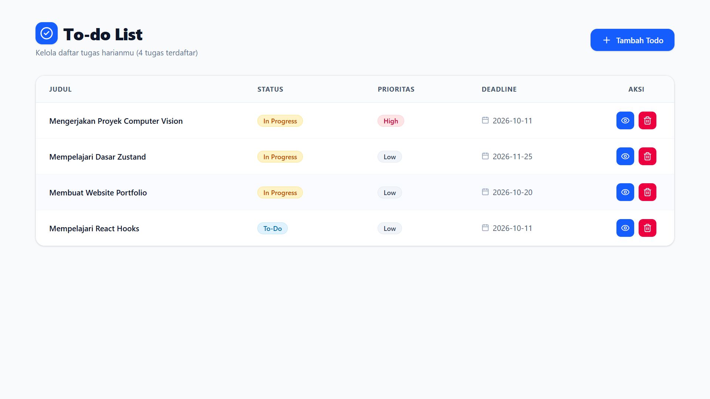
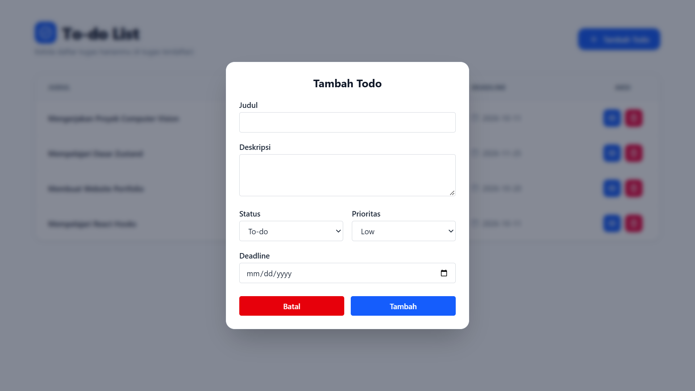
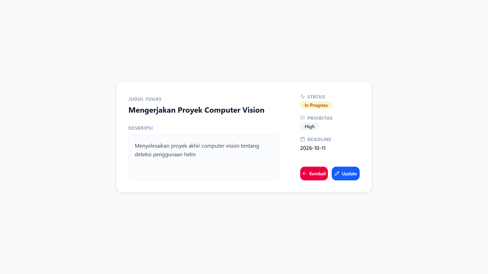
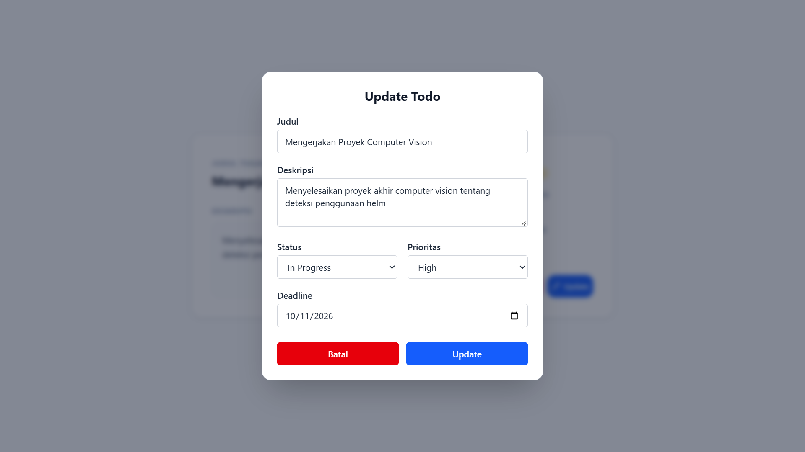
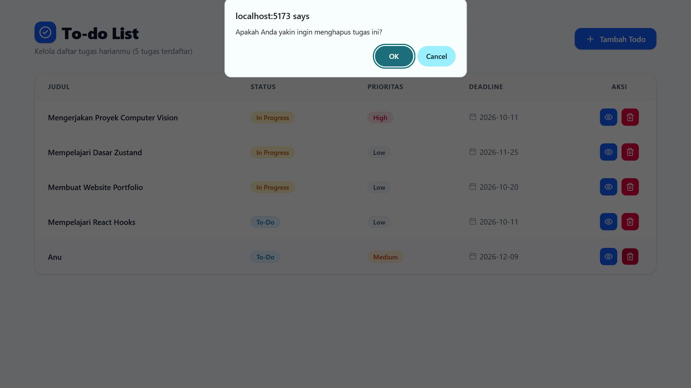

Nama : Arie Ardinata Kusuma
NIM : 251401046
Praktikum Pemrograman Web - Quiz

# Aplikasi To-Do List – React.js

Aplikasi manajemen daftar tugas sehari-hari berbasis frontend yang dikembangkan menggunakan **React.js (Vite)** dan **Tailwind CSS**, dengan pengelolaan data secara _real-time_ menggunakan **React State**.

## Fitur Utama

- **Menampilkan Daftar Tugas:** Menampilkan ringkasan tugas (judul, status, prioritas, dan deadline) dalam bentuk tabel.
- **Menambahkan Tugas:** Menambahkan tugas baru melalui modal formulir tanpa perlu memuat ulang halaman.
- **Melihat Detail Tugas:** Menampilkan informasi lengkap suatu tugas (termasuk deskripsi) pada halaman detail (`/todo/:id`).
- **Memperbarui Tugas:** Mengubah informasi tugas yang sudah ada melalui modal update.
- **Menghapus Tugas:** Menghapus tugas yang tidak diperlukan dengan konfirmasi pengguna.

## Teknologi yang Digunakan

- React.js (Vite)
- Tailwind CSS
- React Router DOM
- Lucide React (Icons)

## Cara Menjalankan Aplikasi

1. Clone repository ini:
   ```bash
   git clone https://github.com/arieeksm/todo-quiz-pemweb.git
   ```
2. Masuk ke folder proyek:
   ```bash
   cd todo-react-quiz
   ```
3. Install dependencies:
   ```bash
   npm install
   ```
4. Jalankan server development:
   ```bash
   npm run dev
   ```

## Screenshot Hasil Implementasi

### 1. Halaman Utama (Daftar Tugas)



### 2. Modal Tambah Tugas



### 3. Halaman Detail Tugas



### 4. Modal Update Tugas



### 5. Konfirmasi Hapus Tugas


